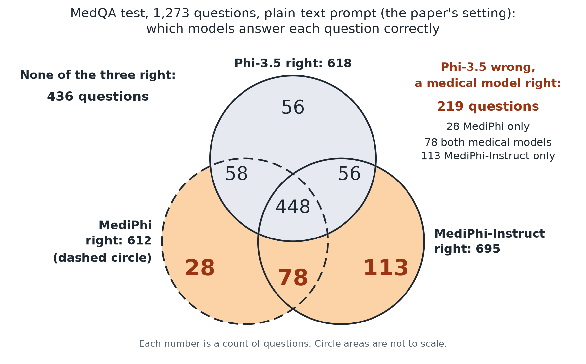

# Results so far - summary for Filippos (2026-11-23)

Everything below is a factual record of runs made between 2026-11-21 and 2026-11-23 on one MacBook, with GPT-6
Astra driven through Codex. None of it has been reviewed yet. Exact protocols, numbers and limits are in the
linked results files.

**Short version.** MediPhi-Instruct's MedQA advantage over Phi-3.5 exists only when the question is given as
plain text without the chat template. Astra located it in the early layers and built a partial weight transfer,
but withdrew it by its own rule; on the test split that transfer gains 2.3 points in the plain-text format and
loses 0.9 in the chat format. The no-donor editing session and the layer-looping scan found no reliable gain.

## 1. Is there a gap to explain? (EXP-04, MedQA test, 1,273 questions)

| Prompt | Phi-3.5 | MediPhi | MediPhi-Instruct |
|---|---|---|---|
| Chat prompt with an instruction line | 57.19 % | 56.32 % | 56.48 % |
| Bare prompt (lm-evaluation-harness format, no chat template) | 48.55 % | 48.08 % | 54.60 % |
| The same bare text inside the chat template | 55.30 % | 55.22 % | 55.62 % |
| MediPhi paper, appendix Table 13 | 48.6 % | 49.1 % | 54.8 % |

- The paper's numbers reproduce only in the bare format. Wrapping the same text in the chat template removes
  MediPhi-Instruct's lead (+6.05 points becomes +0.31).
- In the bare format Phi-3.5 puts 4 % of its next-token probability on the four answer letters,
  MediPhi-Instruct 41 %.
- With step-by-step reasoning (400 test questions): 63.0 %, 60.0 %, 57.8 %.
- The editing experiments below score the bare prompt with our own code, which gives Phi-3.5 48.70 % on the test
  split (620 questions right against 618 in the harness-format run).

### Which questions the medical models get and Phi-3.5 misses (bare prompt)


Of the 1,273 test questions, Phi-3.5 misses 219 that at least one medical model gets right: 113 only
MediPhi-Instruct, 78 both, 28 only MediPhi. Of the 191 that MediPhi-Instruct gets and Phi-3.5 misses, Phi-3.5
answers 134 correctly under the chat prompt, and its wrong pick under the bare prompt is "A" in 100 of them.
The full list is in [picks_test.csv](../../experiments/exp_04_medqa_baseline/processed/picks_test.csv).

### The prompts
The answer is the letter with the highest next-token probability at the end of the prompt.

Bare prompt (plain text, nothing before or after):
```
Question: {question}
A. {option A}
B. {option B}
C. {option C}
D. {option D}
Answer:
```

Chat prompt (Phi-3.5's chat template around one user message):
```
<|user|>
The following is a multiple choice question about medical knowledge. Answer with the letter of the correct option only.

{question}

A. {option A}
B. {option B}
C. {option C}
D. {option D}

Answer:<|end|>
<|assistant|>
```

The control in row 3 is the bare text placed between `<|user|>` and `<|end|>`, with no instruction line.
Astra's own task prompts (about 13,000 and 10,000 characters) are in the repo:
[donor session](../../experiments/exp_05_medical_circuit/raw/transfer1/message.txt),
[no-donor session](../../experiments/exp_06_failure_guided_editing/raw/run1/message.txt).

## 2. Main direction: locate and transfer (EXP-05; donor MediPhi-Instruct, bare prompt)
- **Where it lives.** Giving Phi-3.5 the donor's residual stream after layer 10 (or later) makes its remaining
  layers reproduce the donor's answers (97 to 105 % of the margin difference on 60 questions only the donor gets
  right). No single layer's weights carry it: the largest single-layer swap gives 8 % of the effect. What helps
  those questions mostly hurts the ones only Phi-3.5 gets right.
- **Astra's transfer** (30 forward passes): the donor's attention weights and norms in layers 0 to 7 plus 256 of
  8,192 MLP units per layer, 4.25 % of all weights. Copying the weights of the components with the largest
  patching effects (layer 11 MLP, six attention heads) did nothing.
- **How it scored**, paired with the unedited model:

  | Questions | Bare prompt | Chat prompt |
  |---|---|---|
  | 1,024 practice questions Astra kept untouched | +1.76 points (SE 1.32) | -0.29 (SE 0.81) |
  | Test split, 1,273 (scored once, after the session) | 48.70 % to 50.98 %, +2.28 (SE 1.10, p = 0.046) | 57.19 % to 56.32 %, -0.86 (SE 0.75) |

  The whole donor is at 54.60 % (bare) and 56.48 % (chat) on the test split. Astra's rule, set before its
  confirmation passes, asked for a bare gain above 2 standard errors and no fall under the chat prompt; it
  withdrew the transfer and submitted no edit.
- **Where the gain sits.** On test questions Phi-3.5 already answers correctly under the chat prompt: +4.67
  points (SE 1.50); on the others: -0.92 (SE 1.61). Astra reads this as better prompt handling, not new medical
  knowledge.

## 3. Experiment 1: failure-guided editing without a donor (EXP-06)
Astra kept no edit; test accuracy stayed at 57.19 %. Its best candidate, one MLP unit in layer 26, gained +1.95
points on the 512 questions used to choose it and +0.68 (SE 0.54) on 1,024 untouched ones. It found that Phi-3.5
answers A too rarely (recall 49 % for A, 63 to 66 % for B, C, D); correcting that did not raise accuracy.

## 4. Experiment 2: training-free layer looping (EXP-07)
28 configurations on 600 dev questions, chat prompt. None improves accuracy at p < 0.05. Best: the damped rule
(Chen et al.) on layers 10 to 13, +1.83 points (p = 0.19), mean margin +0.63 (SE 0.19). Plain repetition of
early layers costs 3.8 to 7.0 points. The follow-up sweep around layers 10 to 13 has not been run.

## 5. MIT replication
- Experiment 3: replicated. Corpus identified in 6 of 6 Astra conversations; all 10 copying heads found; one
  head over-called in two conversations.
- Experiment 8: MIT's Qwen3.5-0.8B edit rebuilt bit for bit. Scaled-down check (48 GSM8K problems, half MIT's
  token limit): 12 to 25 correct (p = 0.001), answers running to the token limit 36 to 15. Astra's own session on
  Qwen has not produced a pass yet.
- Experiment 7: not run; the Gemma licence is not accepted yet.

## Limits
- Each Astra result is one session of 30 forward passes.
- The transfer's test-split gain is a single comparison near the usual threshold, with the chat guardrail
  slightly negative, and no control transfer was scored on untouched questions.
- Patching used question sets selected by outcome (60 per set).
- The MediPhi paper does not state its MedQA prompt. We found it neither in the paper (arXiv and ACL versions),
  nor in the model cards, nor in any released code; the bare format is our inference from the match in numbers.
- The model card recommends the instruction in the system role. Our chat prompt has it in the user turn, and a
  system-role variant has not been scored.

## Questions for you
1. Is the bare-prompt gap still the right target, given that it disappears with the chat template? Or should we
   move to a benchmark or donor with an advantage under the chat prompt?
2. Is it worth spending runs on the controls for the transfer and on the layer 10 to 13 follow-up?
3. Compute: everything ran on a laptop. Larger sessions and MIT's full evaluation need a GPU machine.

## Where things are
- Results files: [EXP-04](../../experiments/exp_04_medqa_baseline/RESULTS.md),
  [EXP-05b](../../experiments/exp_05_medical_circuit/RESULTS.md),
  [EXP-05c](../../experiments/exp_05_medical_circuit/RESULTS_05c.md),
  [EXP-06](../../experiments/exp_06_failure_guided_editing/RESULTS.md),
  [EXP-07](../../experiments/exp_07_layer_looping/RESULTS.md),
  [MIT exp 3](../../experiments/exp_01_mit3_language/RESULTS.md),
  [MIT exp 8](../../experiments/exp_03_mit8_math/RESULTS.md).
- Viewer screenshots: [patching by layer](../attachments/viz_exp05b_patching_activations.jpg),
  [every transfer Astra scored](../attachments/viz_exp05c_transfers.jpg),
  [the transfer's weights](../attachments/viz_exp05c_candidate_weights.jpg),
  [layer looping](../attachments/viz_exp07_looping_scan.jpg).
